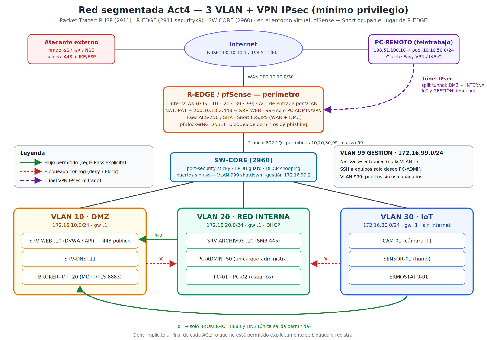

# Diseño de red segura en Packet Tracer (Paso 3)

- Direccionamiento y puertos: [`configs/direccionamiento.md`](configs/direccionamiento.md)
- Configuraciones listas para pegar: [`R-EDGE`](configs/R-EDGE.txt), [`SW-CORE`](configs/SW-CORE.txt), [`R-ISP`](configs/R-ISP.txt)

## Cómo armarlo (Packet Tracer 8.2)

1. **Equipos**: 2 routers ISR 2911 (R-ISP, R-EDGE), 1 switch 2960-24TT (SW-CORE),
   4 servidores (SRV-WEB, SRV-DNS, BROKER-IOT, SRV-ARCHIVOS), 4 PC (PC-ADMIN, PC-01,
   PC-02, PC-REMOTO) y 3 dispositivos IoT (*End Devices > Home*: Webcam, Smoke Detector,
   Thermostat; en *Config* cambiar la conexión a FastEthernet).
2. **Cables** (cobre directo): R-EDGE Gi0/0 ↔ R-ISP Gi0/0; R-EDGE Gi0/1 ↔ SW-CORE Gi0/1;
   PC-REMOTO ↔ R-ISP Gi0/1 (o a un switch en esa red); equipos al switch según la tabla.
3. **R-EDGE**: activar la licencia `securityk9`
   (`license boot module c2900 technology-package securityk9`, `write`, `reload`) y pegar
   `R-EDGE.txt` en `configure terminal`. Pegar `SW-CORE.txt` y `R-ISP.txt` en sus equipos.
4. **IP fija** en los servidores (gateway .1, DNS 172.16.10.11) y en PC-ADMIN
   172.16.20.50; PC-01/PC-02 e IoT por DHCP. En SRV-DNS crear el registro
   `www.act4.local → 172.16.10.10`; en SRV-WEB dejar solo HTTPS encendido.
5. **VPN**: en PC-REMOTO (IP 198.51.100.10/24, gw 198.51.100.1) → *Desktop > VPN*:
   GroupName `ACT4-REMOTO`, Group Key `Act4-Grupo-PSK-2026`, Host IP `200.10.10.2`,
   usuario `vpnuser1`. Debe recibir una IP 10.10.50.x.
6. Guardar como `act4-red-segura.pkt` en esta carpeta.

## Pruebas de validación (capturas para el reporte)

| # | Desde | Prueba | Esperado | Demuestra |
|---|---|---|---|---|
| 1 | PC-01 | `https://172.16.10.10` (navegador) | Carga | INTERNA → servicio DMZ permitido |
| 2 | PC-01 | `ping 172.16.30.21` (cámara) | Falla | INTERNA no llega a IoT |
| 3 | CAM-01 / SENSOR | `ping 172.16.20.10` | Falla (ACL-IOT-IN) | IoT no llega a INTERNA |
| 4 | SRV-WEB | `ping 172.16.20.10` | Falla (ACL-DMZ-IN) | DMZ comprometida no salta a INTERNA |
| 5 | PC-01 | `ssh -l admin 172.16.20.1` | Rechazado | Solo PC-ADMIN administra |
| 6 | PC-ADMIN | `ssh -l admin 172.16.20.1` | Conecta | Administración autorizada |
| 7 | PC-REMOTO | VPN conectada → `https://172.16.10.10` y `ping 172.16.20.10` | OK | Acceso remoto cifrado |
| 8 | PC-REMOTO (VPN) | `ping 172.16.30.21` | Falla (ACL-HACIA-IOT-OUT) | La VPN no da acceso a IoT |
| 9 | PC-REMOTO sin VPN | `ping 172.16.20.10` | Falla | La red interna no es alcanzable desde Internet |
| 10 | R-EDGE | `show crypto isakmp sa` / `show crypto ipsec sa` | QM_IDLE, contadores encaps/decaps | Túnel IPsec activo |
| 11 | R-EDGE | `show access-lists` | Contadores en las líneas `deny ... log` | Bloqueos registrados |

> Packet Tracer simula IPsec con grupos DH 1/2/5. En el pfSense real se usa IKEv2 con DH 14+
> y AES-GCM (ver [`../perimetro-pfsense`](../perimetro-pfsense)).

## Justificación: principio de mínimo privilegio

La red se divide por **nivel de confianza y función**, y cada zona recibe solo los flujos
que su función necesita; todo lo demás cae en un *deny* explícito con registro.

| Zona | Confianza | Qué puede hacer | Qué se le niega y por qué |
|---|---|---|---|
| **DMZ** (VLAN 10) | Baja: recibe tráfico de Internet | Responder a sus clientes, salir a 80/443 para actualizaciones, DNS | **Iniciar conexiones a INTERNA, IoT o gestión.** Es la zona con mayor probabilidad de ser comprometida (DVWA mostró SQLi y XSS); si cae, el atacante queda contenido. |
| **INTERNA** (VLAN 20) | Alta: usuarios y datos | Usar el web de la DMZ (443), DNS, Internet 80/443 | Llegar a IoT y a gestión, salvo **una** estación (PC-ADMIN). Un usuario con malware no puede administrar equipos ni tocar cámaras. |
| **IoT** (VLAN 30) | Muy baja: firmware sin parches, credenciales por defecto | Hablar solo con su broker MQTT/TLS (8883) y el DNS | **Internet directo y cualquier acceso a INTERNA.** Evita que una cámara vulnerable sea puerta de entrada o parte de una botnet (Mirai). |
| **GESTIÓN** (VLAN 99) | Crítica | Responder a PC-ADMIN por SSH | Todo lo demás. Además no se usa la VLAN 1 y los puertos sin uso están en la VLAN 999 apagados (evita VLAN hopping). |
| **VPN** (10.10.50.0/24) | Media: usuario autenticado fuera de la red | Split tunnel solo a DMZ e INTERNA | IoT y gestión. El usuario remoto recibe lo mismo que un usuario interno, no más. |

Controles de capa 2 que refuerzan la segmentación: troncal con VLAN permitidas
explícitas y `nonegotiate` (sin DTP), port-security con MAC *sticky*, BPDU guard y DHCP
snooping (bloquea servidores DHCP falsos). El acceso de administración (SSH v2, `scrypt`,
`login block-for`) se limita con `access-class` a PC-ADMIN y la VPN.
